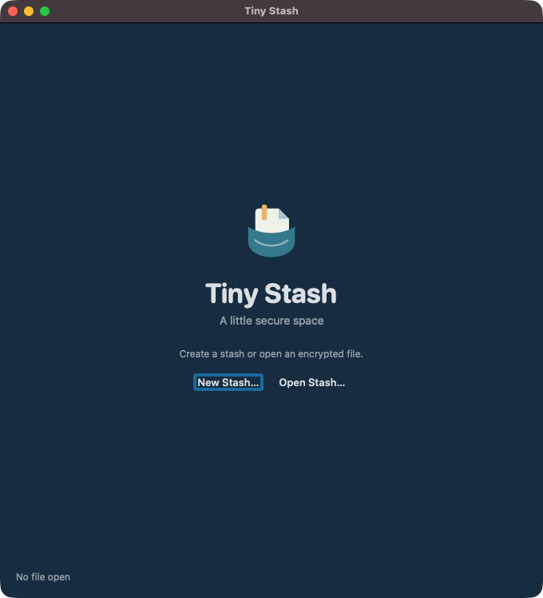

# Tiny Stash

One little note. For your eyes only.

An encrypted scratchpad for the API keys, tokens, passwords, and other sensitive snippets you keep handy while developing or testing. Instead of leaving them in an open TextEdit or Sublime Text tab—or a plain-text file in your project—keep them in one small note that locks when you switch away.

Use it for a quick testing session or keep the encrypted file for later. Native Swift/AppKit on macOS, with no dependencies, accounts, built-in sync, server, or plugins.



### Why not just a text editor?

- **Encrypted files, not plain-text scratch files.** Each edit is encrypted before it is saved. An AI coding agent or other process reading the file gets ciphertext, not the note's contents.
- **Locked when you switch away.** Focus-loss locking is on by default, so secrets do not stay visible in an unattended editor tab.
- **Note text excluded from Accessibility.** The editor does not expose its contents through the standard Accessibility tree, reducing exposure to tools that read other apps through that interface.

**Not an isolation boundary against AI agents or other local processes.** An agent with screen-capture access may see an unlocked note; copied secrets enter the system clipboard. Tiny Stash does not protect against software controlling your login session or a compromised OS. See [Boundaries](#boundaries).

Licensed under the [MIT License](LICENSE).

## Use

1. Choose **New Stash…** (⌘N), pick a new `.tinystash` filename and location, then enter and confirm a strong, unique file password.
2. Type in the single plain-text page. Each edit is encrypted and atomically saved to that file.
3. Lock, or leave the app with focus locking enabled (the default): the editor is covered, its text/undo history is cleared, and the in-memory key is released.
4. Choose **Open Stash…** (⌘O), or open the file with Tiny Stash in Finder. Enter the same file password to reopen it.

**Close the stash before moving or renaming it.** The file contains everything needed to decrypt it with its password; moving it to another folder or another Mac does not require a Keychain export. The other Mac needs Tiny Stash and the file password. Only one file is edited at a time. Concurrent editing and cloud-provider conflict resolution are not supported.

The **file password is separate from your Mac login password**. It is not stored in the file or Keychain. There is no password reset or recovery backdoor: keep both a ciphertext backup and the password somewhere safe. A weak password can be guessed offline by anyone with a copy of the file.

### Settings

Open **Tiny Stash → Settings…** (⌘,) to choose **System**, **Light**, or **Dark** appearance and toggle **Lock when Tiny Stash loses focus**. Choices persist on this Mac and take effect immediately. Disabling focus locking leaves the editor visible when switching apps or windows. Minimizing, sleep, inactive user sessions, and screen locking still lock the stash.

### Optional local unlock

Before password unlock/creation, check **Remember on this Mac** to enable Touch ID or your Mac password for this file. This remembers the random encryption key in the device-only, non-synchronizing Data Protection Keychain. A fresh user-presence check protects later retrieval. The Keychain account uses the file's stable UUID, not its path, so local unlock survives a move or rename.

This convenience requires a correctly signed/provisioned build. If Keychain access is unavailable, password-based file access still works. On another Mac, use the file password first and independently enable local unlock there. A copied file does not carry a Touch ID enrollment or Mac login password with it.

## Build

Requires macOS 14+, Xcode and Swift 6.

```sh
swift test
bash scripts/build.sh release
open "build/Tiny Stash.app"
```

The default ad-hoc build supports portable password unlock and save. Real-identity signing uses a secure timestamp and requires network access. A provisioning profile is optional for password-only builds; optional Keychain unlock requires a matching macOS profile authorizing the selected certificate, target Mac where applicable, and `TEAMID.dev.ryandetzel.fold` (or a matching wildcard). Keep signing material outside the repository:

```sh
bash scripts/build.sh release \
  --identity 'Apple Development: Your Name (TEAMID)' \
  --profile /absolute/path/to/TinyStash.provisionprofile
open "build/Tiny Stash.app"
```

`SIGNING_IDENTITY` and `PROVISIONING_PROFILE` are equivalent environment settings. The script checks profile platform, team and application-ID compatibility; macOS enforces profile validity, certificate/device authorization and expiry. Hardened Runtime is enabled without `get-task-allow`. Local builds are signature-verified but are **not notarized distribution releases**.

For distribution, configure credentials interactively in your Keychain, then explicitly request notarization:

```sh
xcrun notarytool store-credentials TinyStash
bash scripts/build.sh release --distribute \
  --identity 'Developer ID Application: Your Name (TEAMID)' \
  --notary-profile TinyStash
```

`NOTARYTOOL_PROFILE` is the equivalent environment setting for the Keychain profile name. Add `--profile /absolute/path/to/TinyStash.provisionprofile` with a matching Developer ID profile to enable local Keychain unlock. Never commit credentials, private keys, certificates, provisioning profiles, or personal notes; ignore rules exclude common forms of these files.

Distribution succeeds only after notarization acceptance, ticket stapling/validation, signature verification and Gatekeeper assessment. Share `build/Tiny Stash-notarized.zip`; its ticket is included. Builds target the current architecture, not a universal binary. Quit the running app before rebuilding its bundle. Developer ID signing, notarization and successful authenticated Keychain access still require credentialed verification before shipping.

The bundle identifier remains `dev.ryandetzel.fold`. New per-file convenience keys use service `dev.ryandetzel.tinystash.portable-vault.encryption`, with the file UUID as the account. Changing signing teams may disconnect local convenience keys, but does not prevent password unlock of portable files.

## File format and saving

- Each file has an independent random 256-bit content key, UUID, and 32-byte salt. PBKDF2-HMAC-SHA256 with 600,000 iterations derives a password wrapping key; AES-GCM encrypts the content key under it.
- Version 1 has a 128-byte header: magic, version, KDF identifier/parameters, UUID, salt, and wrapped key. The encrypted text follows. The key wrap authenticates the metadata; content encryption authenticates the full header. All AES-GCM operations use fresh random nonces. Invalid versions/parameters/lengths are rejected before password derivation.
- Tiny Stash writes only ciphertext and nonsecret format metadata to note files. New files and temporary files have mode `0600`; newly created directories have mode `0700`. Existing destination-folder permissions are never changed.
- New Stash refuses to overwrite any existing destination, including a symlink. Autosave uses private temporary files and atomic replacement. Encrypted files are limited to 16 MiB; bounded reads reject larger files and non-regular files before loading their contents. Oversized saves preserve the existing file and retain pending edits.
- A disk-write failure retains pending **ciphertext in memory**. Unlock authenticates the pending ciphertext and retries saving. If the retry fails or the disk copy is missing/damaged, recovered text remains accessible for copying somewhere safe, with an unsaved warning. Opening another file and ordinary quit/close are refused while edits remain unsaved. A force quit, crash, or power loss can still lose pending edits.
- Exceptional encryption failure retains hidden editor text in memory rather than silently discarding edits; older pending ciphertext is discarded so it cannot overwrite the newest text during recovery. The key is released and fresh unlock is required. Do not quit if warned about unsaved edits.
- Focus loss locks the editor by default and can be disabled in Settings. Minimizing, sleep, inactive user sessions, and screen-lock notifications always lock it. Late asynchronous password/Keychain results cannot reveal it after locking or switching files.
- The editor remembers its window size and position for the next unlock, including after relaunching. The lock screen can expand to fit its controls without overwriting that frame; resizing the lock screen does not change the saved editor size. The editor's minimum window size is 380 × 260 points, versus 480 × 660 for the lock screen.

### Legacy page

The old `~/Library/Application Support/Fold/page.aesgcm` and its `dev.ryandetzel.fold.encryption` / `page-key` Keychain entry are left untouched. That format did not have a portable password, and the new file picker does not convert it. Recovering its contents still requires its original key and signing/Keychain access. Creating a new portable stash does not recover, replace, or delete the legacy page.

## Verification

- Cryptographic/storage tests cover an independently derived version-1 fixture, move/rename/password reopening, wrong passwords, authenticated metadata/content tampering, malformed parameters, fresh nonces, independent file keys, invalid UTF-8, atomic no-clobber creation, failed-save preservation, and existing parent-folder permissions.
- An isolated copy of the actual app, with a different bundle identity and no Keychain authorization, exercised native New Stash location/password confirmation, password unlock, edit/autosave, focus-loss/manual lock, moved/renamed-file reopening with the same password, and wrong-password rejection without changing ciphertext.
- A separate process decrypted the UI-created/edited files with the file password and checked exact content and absence of plaintext/password bytes on disk. An immutable-file smoke scenario verified failed-save preservation, refusal to switch files with pending edits, and recovery after restoring write access.
- The locked portable-file UI was visually inspected; the unlocked editor was absent from the Accessibility tree.
- Production-hardening verification reproduced and fixed recovery of an older pending edit after a later encryption failure. A throwaway actual-controller harness injected the failure and verified the latest text survived unlock and encrypted persistence. Gitleaks found no leaks in the working tree or available Git history; this is not a guarantee that no credential has ever been exposed.
- The hardening run passed all 21 Swift tests and an ad-hoc release build with strict signature verification. Additional controller smoke scenarios verified recovery with a missing disk file, rejection of a wrong recovery key, retained unsaved protection, and rejection of an oversized file. Credential-dependent distribution and successful biometric authentication were not exercised.

Touch ID/Mac-password successful authentication still needs interactive verification on a provisioned build. Do not infer authenticated Keychain success from the password smoke runs. Use fake secrets during development verification.

## Boundaries

This protects stored data from ordinary file reads, not a compromised OS or an attacker controlling your login session. Accessibility exclusion intentionally prevents screen-reader access to note text. Screen capture can reveal the visible page. Copying text puts it on the system clipboard, outside Tiny Stash; there is no timed clipboard clearing. Swift/Objective-C object release does not guarantee plaintext memory erasure. File names, locations, format metadata, and sizes are not secret. There is no password-change feature; keep the file password available even when using local biometric convenience.

## Logo and app icon

The lock screen and Dock icon share a folded note tucked into a blue pocket, with an amber bookmark tab. The native lock screen uses a rounded wordmark and compact password form, with a pale-paper background in Light mode and an ink-blue background in Dark mode.

`Resources/TinyStash.icns` includes standard and Retina icon representations from 16 to 1024 pixels. After changing the vector master, regenerate it on macOS:

```sh
mkdir -p build
swiftc -parse-as-library Sources/TinyStash/BrandArtwork.swift scripts/GenerateIcon.swift \
  -o build/GenerateIcon
build/GenerateIcon build/TinyStash.iconset
iconutil -c icns build/TinyStash.iconset -o Resources/TinyStash.icns
bash scripts/build.sh release
```

## Source map

- `Sources/TinyStash/App.swift`: window, File menu/Finder opening, lifecycle and quit protection.
- `Sources/TinyStash/NoteController.swift`: file selection/creation, password/local unlock, private editor, autosave and locking.
- `Sources/TinyStash/SettingsController.swift`: persistent focus-loss/appearance settings, native Settings window, and appearance-aware background.
- `Sources/TinyStash/BrandArtwork.swift`: shared vector pocket-and-note logo and brand palette.
- `Sources/TinyStash/PortableVault.swift`: versioned password-wrapped AES-GCM envelope.
- `Sources/TinyStash/KeychainStore.swift`: opt-in per-file user-presence-protected convenience keys.
- `Sources/TinyStash/EncryptedStore.swift`: private atomic writes and no-clobber creation.

Apple references: [TN3137: macOS Keychains](https://developer.apple.com/documentation/technotes/tn3137-on-mac-keychains), [TN3125: provisioning profiles](https://developer.apple.com/documentation/technotes/tn3125-inside-code-signing-provisioning-profiles), [authenticated Keychain items](https://developer.apple.com/documentation/localauthentication/accessing-keychain-items-with-face-id-or-touch-id).
